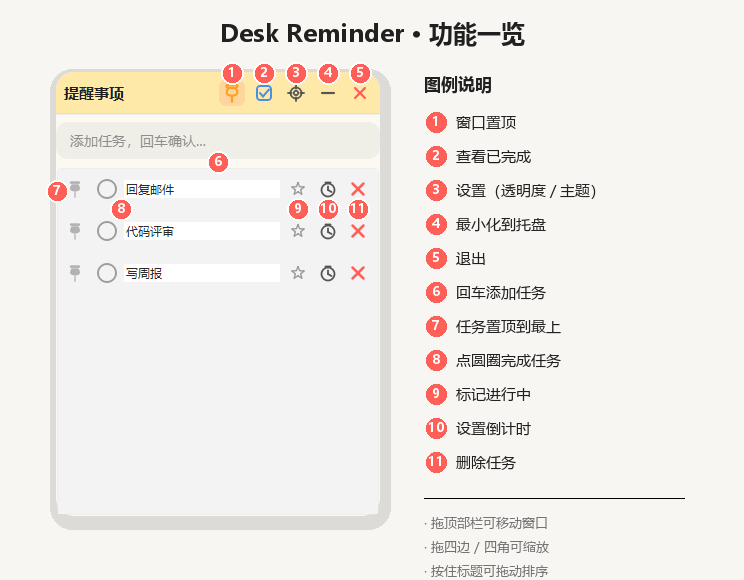

# Desk Reminder · 桌面提醒事项

**中文** | [English](README_EN.md)

一个贴在 Windows 桌面上的轻量待办工具，风格参考 macOS「提醒事项」。

无边框圆角窗口、可拖边框缩放、一键置顶、背景透明度可调；任务点圆圈完成，支持倒计时提醒。纯本地运行，对方电脑不用装 Python。

给非程序员直接发安装包 `DeskReminder-Setup.exe`。程序员要改程序或自己打包，看下面的「开发运行」和「打包」。

## 功能一览

一张图看懂各个图标：



| 功能 | 说明 |
|------|------|
| 任务管理 | 回车快速添加；点左侧圆圈完成；可编辑标题、删除 |
| 完成后自动消失 | 勾选完成约 0.7 秒后淡出，记录保留在「已完成」 |
| 已完成视图 | 标题栏蓝色勾选框切换；可取消完成、编辑、删除 |
| 窗口置顶 | 标题栏地图钉，一键置顶不被覆盖 |
| 任务置顶 | 任务行左侧小图钉，一键把该任务顶到列表最上方 |
| 背景透明度 / 主题 | 齿轮打开设置，调透明度，切换预设配色 |
| 拖动 / 缩放 | 拖顶部栏移动；拖四边 / 四角调整大小 |
| 任务排序 | 按住任务标题上下拖，可调整顺序并保存 |
| 标记进行中 | 任务行星标高亮，可同时高亮多条 |
| 倒计时 | 时钟图标设 5 / 10 / 25 分钟或自定义；到点托盘通知 |
| 系统托盘 | 最小化到托盘；退出可选托盘或直接退出 |
| 数据持久化 | SQLite 本地存储，关闭再开任务、顺序、高亮都还在 |

## 环境要求

- Windows 10 / 11
- 安装包或便携 exe：无需 Python
- 开发运行：Python 3.10+（推荐 3.11 / 3.12 / 3.13）

## 安装使用

非程序员用安装包即可，不用看源码。

1. 双击 `DeskReminder-Setup.exe`。未签名时 SmartScreen 可能拦截，选「更多信息 → 仍要运行」。
2. 按向导选择：为所有用户（默认 `C:\Program Files\DeskReminder\`，会弹一次 UAC）或仅为我（默认 `%LOCALAPPDATA%\Programs\DeskReminder\`）。
3. 可改安装位置。桌面快捷方式默认勾选，可以取消。开始菜单快捷方式一定会创建。
4. 装完后按 Win 键搜 `Desk Reminder` 即可打开。卸载在「设置 → 应用」里。

卸载只删除程序和快捷方式，不删除任务数据。便携 exe（`DeskReminder.exe`）仍然可以直接双击使用，适合自己拷一个文件就跑。

## 开发运行

```bash
# 1. 克隆仓库
git clone https://github.com/PureLoveWarriors/desk_reminder.git
cd desk_reminder

# 2. 安装依赖
pip install -r requirements.txt

# 3. 启动
python main.py
```

## 打包

两种产物都保留。`build.py` 只打便携 exe；安装包是在这个 exe 上再包一层，不改程序代码。

```bash
pip install -r requirements.txt
pip install pyinstaller
python build.py
```

生成 `dist/DeskReminder.exe`（单文件，约 40–50MB）。图标是缩小版的任务列表界面（`assets/icon.ico`）。这个文件可以单独拷走使用。

要再打安装包，本机需已安装 [Inno Setup 6](https://jrsoftware.org/isdl.php)，然后：

```bash
python build_setup.py
```

生成 `dist/DeskReminder-Setup.exe`。发给非程序员用这个文件。

> `python build.py` 会先尝试覆盖旧的 `dist/DeskReminder.exe`；若文件被占用，会结束正在运行的实例再继续。仍失败时请先退出程序后重试。  
> 安装包和便携 exe 都没做代码签名。首次运行可能被 Windows SmartScreen 拦截，选「更多信息 → 仍要运行」即可。

## 使用说明

1. **添加任务**：在输入框输入内容，按回车。
2. **完成任务**：点任务左侧圆圈，任务会淡出并进入「已完成」。
3. **查看已完成**：点标题栏蓝色勾选框；再点一次回到待办。
4. **窗口置顶**：点标题栏地图钉；亮色表示已置顶。
5. **任务置顶**：点任务行左侧小图钉，该任务移到列表最上方。
6. **调透明度 / 换主题**：点齿轮，拖滑块或点色块。
7. **调整顺序**：按住任务标题上下拖（仅待办列表）。
8. **高亮进行中**：点任务行星标，再点一次取消。
9. **倒计时**：点时钟选时长；到点托盘通知。
10. **最小化**：点「–」收入托盘；点托盘图标可再打开。
11. **退出**：点红色叉可选「最小化到托盘」或「直接退出」；托盘右键「退出」始终直接退出。

## 数据存放位置

配置与任务数据库在用户目录下：

```
C:\Users\<用户名>\.deskreminder\
├── config.json    # 窗口位置、透明度、置顶、主题等
├── reminder.db    # 任务数据（SQLite）
└── error.log      # 异常日志（若有）
```

删除该文件夹即可清空所有数据、恢复默认。

> 数据按本机用户隔离，不会在多台电脑间自动同步。

## 项目结构

```
desk_reminder/
├── main.py                 # 程序入口
├── build.py                # PyInstaller，打出便携 exe
├── build_setup.py          # 把便携 exe 打成安装包
├── requirements.txt
├── installer/              # 安装脚本、免责声明、中文向导
├── assets/
│   └── icon.ico            # 程序图标
├── docs/screenshots/       # README 效果图
└── app/
    ├── config.py           # 配置读写、配色主题预设
    ├── core/
    │   └── db.py           # SQLite 任务读写
    └── ui/
        ├── main_window.py  # 主窗口（置顶 / 拖动 / 缩放 / 托盘 / 排序）
        ├── task_item.py    # 单条任务（置顶、高亮、倒计时）
        ├── settings.py     # 设置 / 倒计时 / 退出确认面板
        ├── icons.py        # 自绘图标按钮
        ├── theme.py        # 把配色主题渲染进 QSS 模板
        └── styles.qss      # 样式表模板
```

## 技术栈

- **界面**：PySide6（Qt for Python）
- **存储**：SQLite（标准库 `sqlite3`）
- **打包**：PyInstaller（便携 exe）+ Inno Setup（安装包）

## License

MIT（可按需自行修改）
