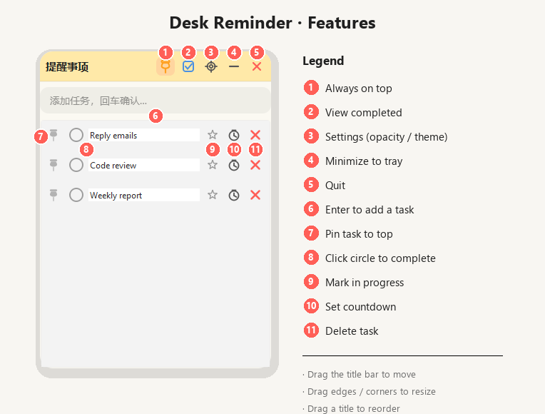

# Desk Reminder

[中文](README.md) | **English**

A lightweight Windows desktop to-do app inspired by macOS Reminders.

Frameless rounded window, resize by dragging edges, always-on-top, adjustable background opacity, circle-to-complete tasks, and countdown reminders. Runs fully offline and packs into a single `.exe` — no Python required on the recipient’s machine.

## Feature overview

Numbered callouts match the legend on the right:



| Feature | Description |
|---------|-------------|
| Task management | Press Enter to add; click the circle to complete; edit title or delete |
| Auto-hide on complete | Completed tasks fade out after ~0.7s and move to Completed |
| Completed view | Toggle via the blue checkbox in the title bar |
| Always on top | Map-pin button pins the window above others |
| Pin task to top | Small pin on each row moves that task to the top of the list |
| Opacity / theme | Gear opens settings: opacity slider and preset color themes |
| Move / resize | Drag the title bar to move; drag edges/corners to resize |
| Reorder | Drag a task title up/down to reorder (active list only) |
| In progress | Star highlight; multiple tasks can be highlighted |
| Countdown | Clock icon: 5 / 10 / 25 min or custom; tray notification when done |
| System tray | Minimize to tray; exit can go to tray or quit |
| Persistence | SQLite locally — tasks, order, and highlights survive restart |

## Requirements

- Windows 10 / 11
- For development: Python 3.10+ (3.11 / 3.12 / 3.13 recommended)
- For the `.exe` only: no Python needed

## Run from source

```bash
git clone https://github.com/PureLoveWarriors/desk_reminder.git
cd desk_reminder

pip install -r requirements.txt
python main.py
```

## Build an `.exe`

```bash
pip install pyinstaller
python build.py
```

Output: `dist/DeskReminder.exe` (single file, roughly 40–50MB), with app icon `assets/icon.ico`.

Share that one file — the other person does **not** need Python.

> Close any running `DeskReminder.exe` before rebuilding, or the pack step may fail with a file lock.  
> First launch may hit Windows SmartScreen — choose **More info → Run anyway**.

## How to use

1. **Add a task** — type in the input box and press Enter.
2. **Complete** — click the circle; the task fades into Completed.
3. **Completed list** — click the blue checkbox in the title bar; click again to return.
4. **Always on top** — click the map pin (highlighted when active).
5. **Pin a task** — click the small pin on the row to move it to the top.
6. **Opacity / theme** — open the gear, drag the slider or pick a color theme.
7. **Reorder** — drag a task title up/down (active list only).
8. **In progress** — click the star; click again to clear.
9. **Countdown** — click the clock, pick a duration; tray notifies when time is up.
10. **Minimize** — click “–” to hide to the tray; click the tray icon to show again.
11. **Quit** — red X can minimize to tray or quit; tray menu **Quit** always exits.

## Data location

```
C:\Users\<username>\.deskreminder\
├── config.json    # window geometry, opacity, pin, theme
├── reminder.db    # tasks (SQLite)
└── error.log      # crash log (if any)
```

Delete that folder to wipe data and restore defaults.

> Data is per Windows user and is not synced across machines.

## Project layout

```
desk_reminder/
├── main.py
├── build.py
├── requirements.txt
├── assets/icon.ico
├── docs/screenshots/
└── app/
    ├── config.py
    ├── core/db.py
    └── ui/
        ├── main_window.py
        ├── task_item.py
        ├── settings.py
        ├── icons.py
        ├── theme.py
        └── styles.qss
```

## Stack

- **UI**: PySide6 (Qt for Python)
- **Storage**: SQLite (`sqlite3`)
- **Packaging**: PyInstaller

## License

MIT
